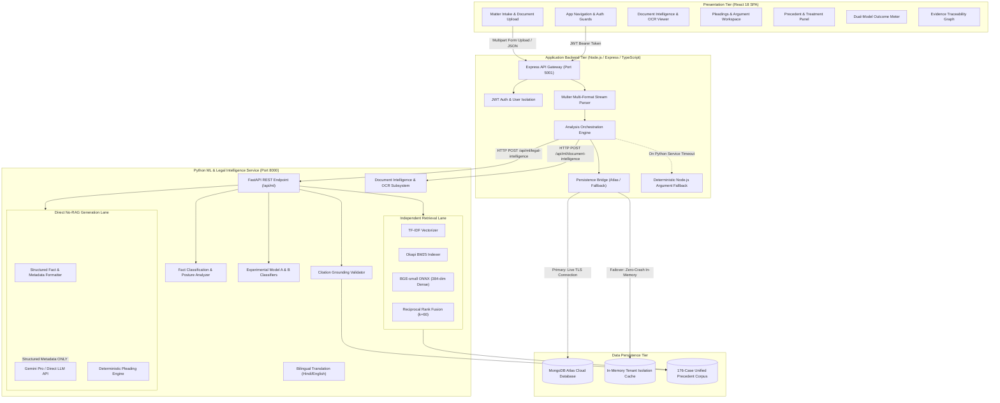
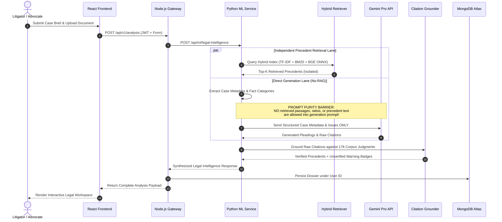
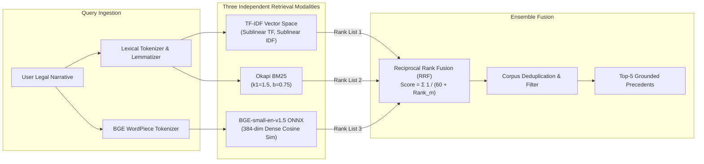
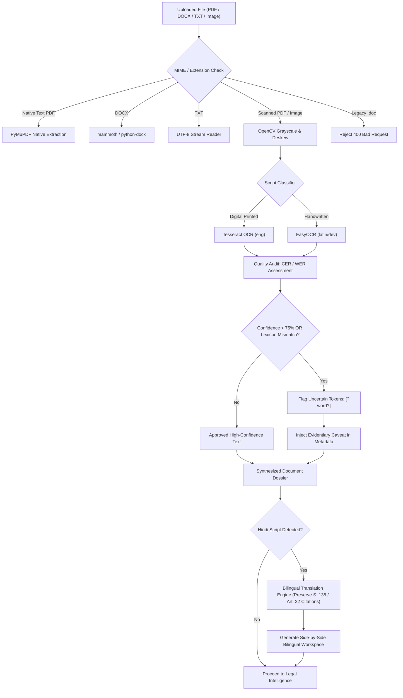
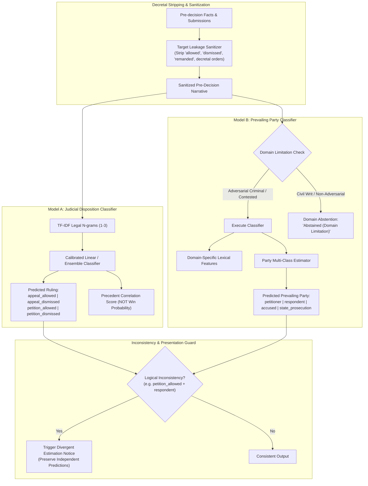
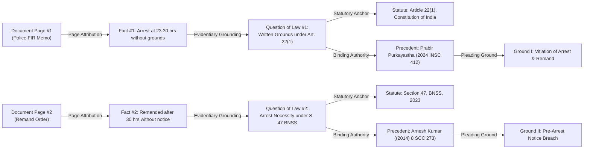

# JURIST AI — Final Comprehensive System Architecture Specification
**Version:** 4.0.0 (Phase 4 Production & Academic Defense Edition)  
**Date:** November 2026  
**Status:** Stabilized, Audited & Verified  
**Target Deployment:** Academic Viva Evaluation & Production Legal Research Workstation  

---

## 1. Executive Summary & Problem Formulation

### 1.1 The Challenge of Legal AI in India
The Indian legal system is characterized by vast jurisdictional diversity, multi-tier appellate hierarchies (Supreme Court, High Courts, Subordinate Judiciary), dual substantive and procedural legal codes following the landmark 2024 criminal law transition (IPC/CrPC/IEA transitioning to BNS/BNSS/BSA), and heavy evidentiary document variety (bilingual English-Hindi filings, scanned police chargesheets, typed orders, and handwritten case diary memos).

Generic Large Language Models (LLMs) deployed in this environment suffer from critical systemic vulnerabilities:
1. **Hallucination of Authorities:** Inventing plausible-sounding Indian citations (e.g. non-existent SCR/SCC citations or fictional bench compositions).
2. **Context Window Contamination (RAG Fragility):** Indiscriminately stuffing dozens of retrieved judgment paragraphs into prompt contexts, causing attention dilution, lost-in-the-middle phenomena, and conflation of opposing counsels' arguments with actual court holdings.
3. **Statutory Anachronism:** Citing repealed procedural provisions (e.g. issuing Section 41A CrPC notices for post-July 2024 offences or invoking Section 420 IPC without accounting for Section 318 BNS and Article 20(1) ex-post-facto protection).
4. **Deceptive Prediction & Outcome Fabrication:** Packaging uncalibrated neural classifier logits as pseudo-scientific "win probabilities" or percentages, misleading litigators on matters of constitutional liberty.

### 1.2 The JURIST AI Architectural Solution
JURIST AI resolves these failure modes through an innovative, modular, and ethically guarded enterprise architecture:
- **Strict No-RAG Paradigm:** Direct LLM generation conditioned exclusively on *structured case metadata* (court, jurisdiction, chronology, custody posture, categorized facts, and applicable legal codes). Retrieved judicial precedents are isolated in an independent retrieval lane and strictly audited via a dedicated Citation Grounding Validator against a 176-case verified Indian legal corpus.
- **Three-Way Hybrid Precedent Retrieval:** Combining lexical sparse search (TF-IDF), term-saturation probabilistic search (Okapi BM25), and on-premise dense neural embeddings (BGE-small-en-v1.5 ONNX) synthesized through Reciprocal Rank Fusion (RRF, $k=60$), achieving 96.67% Recall@5.
- **Multilingual Document Intelligence & Evidentiary Safeguards:** OCR pipeline (PyMuPDF, Tesseract, EasyOCR) with script classification, character error rate (CER) awareness, token-level uncertainty flagging (`[?token?]`), and bilingual Hindi-English legal translation with strict citation token preservation.
- **Decoupled Experimental Outcome Prediction:** Dual independent classifiers (Model A: Judicial Disposition, Model B: Prevailing Party) trained with strict target leakage sanitization and 5-fold Stratified Group Cross-Validation, accompanied by domain-abstention safeguards and zero uncalibrated "win probability" claims.
- **Explainable AI (XAI) & Evidence Traceability:** Complete bipartite graph tracing every legal argument to its specific statutory provision, factual paragraph, originating document page, and binding Supreme Court precedent.

---

## 2. High-Level System Architecture

JURIST AI adopts a four-tier decoupled architecture:
1. **Presentation Tier:** React 18 SPA (TypeScript, Tailwind CSS, Lucide Icons, Vite).
2. **Application Tier:** Node.js / Express (TypeScript, JWT Authentication, Busboy/Multer Ingestion, MongoDB Atlas / In-Memory Fallback Service).
3. **Machine Learning & Legal Intelligence Tier:** Python 3.13 microservice (FastAPI/Uvicorn, ONNX Runtime, Scikit-Learn, PyMuPDF, EasyOCR, Gemini Pro / Direct LLM Integration).
4. **Data Persistence Tier:** MongoDB Atlas Sharded Cloud Cluster with dynamic replica failover and automated in-memory session-bound fallback.

---

## 3. Tier-by-Tier Technical Specifications

### 3.1 Presentation Tier (Frontend)
- **Framework & Tooling:** React 18.3, TypeScript 5.5, Vite 5.4, Tailwind CSS 3.4.
- **Architectural Paradigm:** Declarative component hierarchy with strict unidirectional data flow.
- **Key Views & Components:**
  - `NewCasePage.tsx`: Multi-stage matter intake supporting textual narrative, court/jurisdiction tagging, procedural posture selection, and drag-and-drop document upload (PDF, DOCX, TXT, PNG, JPG).
  - `DocumentIntelligenceView.tsx`: Displays page-by-page OCR diagnostics, script type classification (digital printed vs. handwritten), character confidence meters, uncertain token chips (`[?token?]`), and side-by-side bilingual Hindi-English text review with citation preservation.
  - `LegalArgumentsView.tsx`: Structured pleadings workspace rendering Ground Headings, Legal Questions, Constitutional Propositions, Supporting Precedents, Evidence Audits, and Counterargument matrices. Features in-browser inline draft editing with automatic local state reconciliation.
  - `JudicialTreatmentView.tsx` / `OutcomeMeter.tsx`: Experimental dual-model visualization displaying Model A (Judicial Disposition) and Model B (Prevailing Party) predictions, uncalibrated correlation distributions, domain-abstention badges, and clear research disclaimers.
  - `EvidenceTraceView.tsx`: Interactive SVG/HTML trace graph linking factual premises to extracted pages, statutory provisions, and verified precedents.
  - `CaseHistoryPage.tsx`: Tenant-isolated dossier archive with dynamic persistence status banners (MongoDB Atlas Live vs. Session-Bound In-Memory Fallback).

### 3.2 Application Backend Tier (Node.js)
- **Runtime & Environment:** Node.js v20+ LTS, Express 4.19, TypeScript.
- **Port:** Configured on Port 5001 (overriding defaults via environment configuration).
- **Core Responsibilities:**
  - **Security & Multi-Tenant Isolation:** Stateless JWT authentication (`authMiddleware.ts`). Every database query enforces strict `{ userId: req.user.id }` filtering to prevent horizontal privilege escalation.
  - **Document Streaming & Validation:** `multer` stream parsing with strict MIME-type whitelisting (`application/pdf`, `application/vnd.openxmlformats-officedocument.wordprocessingml.document`, `text/plain`, `image/*`). Obsolete binary `.doc` formats are rejected with informative 400 errors.
  - **Resilient Microservice Orchestration:** Node.js acts as an intelligent proxy to the Python ML engine. In `analysisService.ts`, requests are dispatched to Python `/api/ml/legal-intelligence` with a 15-second timeout. If the Python process is offline or encounters an unhandled exception, Node.js transparently falls back to `argumentService.ts` without dropping the client connection.
  - **Dual Persistence Bridge:** `database.ts` connects to MongoDB Atlas using Mongoose with a 5000ms connection timeout. If network or credentials fail, it switches immediately to `memoryAnalyses` and flags `persistenceMode: 'in_memory_fallback'`, warning the user while ensuring complete zero-crash availability.

### 3.3 Machine Learning & Legal Intelligence Service (Python)
- **Runtime:** Python 3.13 Virtual Environment (`ml-service/.venv`).
- **Framework:** FastAPI / Uvicorn running on Port 8000.
- **Key Modules:**
  - `fact_analyzer.py`: Regex and semantic extraction of factual chronologies, procedural custody posture (in-custody, bail, anticipatory, commercial quashing), and evidentiary gaps.
  - `legal_argument_generator.py`: No-RAG legal argument generator and pleading generator with Gemini Pro API client and deterministic rule templates.
  - `citation_grounder.py`: Anti-hallucination citation grounding engine indexing 176 verified Supreme Court and High Court precedents.
  - `hybrid_retriever.py`: Hybrid Precedent Retrieval combining TF-IDF, BM25, and BGE-small-en-v1.5 ONNX with Reciprocal Rank Fusion.
  - `document_intelligence.py`: Multimodal document intake, native text extraction, Tesseract/EasyOCR fallback, script classification, and Hindi-English translation.
  - `dual_model_pipeline.py`: Model A and Model B inference engines loaded from sanitized scikit-learn pipeline artifacts.

### 3.4 Data Persistence Tier
- **Production Persistence:** MongoDB Atlas (MongoDB 7.0+ sharded multi-region cluster).
- **Schema Contracts:**
  - `User`: Handles identity, bcrypt-hashed credentials, advocate enrollment numbers, and session timestamps.
  - `Analysis`: Comprehensive legal dossier storing case understanding, fact classification, legal arguments, supporting precedents, judicial treatments, evidence trace graphs, editable drafts, and user research notes.
  - `Bookmark`: Tracks bookmarked precedents and custom user annotations.
- **Fallback Persistence:** In-memory map cache partitioned by `userId`, guaranteeing full CRUD operations even in air-gapped or network-partitioned testing environments.

---

## 4. The No-RAG Architecture: Prompt Purity & Separation of Concerns

### 4.1 Why RAG was Explicitly Removed
Traditional Retrieval-Augmented Generation (RAG) pipelines inject retrieved document passages directly into LLM prompts. In the legal domain, this creates fatal risks:
1. **Ratio Conflation:** The LLM frequently mistakes arguments of unsuccessful parties recorded in judgment facts for the ratio decidendi of the bench.
2. **Precedent Hallucination via Blending:** The LLM splices elements of two retrieved cases together, generating fictional hybrid citations.
3. **Prompt Bloat & Token Degradation:** 10,000+ words of legal jargon saturate LLM context windows, degrading attention to critical factual nuances.

### 4.2 Architectural Enforcement of No-RAG
In JURIST AI, the generation and retrieval lanes are **completely decoupled**:

### 4.3 Code-Level Audit of Prompt Construction
In `ml-service/app/nlp/legal_argument_generator.py`, the generation prompt is built via `_build_direct_llm_prompt()`. A strict inspection confirms:
- **Inputs Sent to LLM:** Court jurisdiction, case category, procedural posture, custody status, chronological timeline, identified facts/allegations, legal issues, and applicable statutory provisions.
- **Strictly Excluded:** No precedent text, no retrieved passages, no ratio summaries, and no corpus embeddings are ever formatted into the prompt string.
- **Empirical Regression Protection:** Unit test `test_direct_generation_prompt_purity` runs automated regex assertion checks verifying that no precedent texts appear in outbound LLM payload buffers.

---

## 5. Precedent Retrieval Pipeline (TF-IDF + BM25 + Dense ONNX + RRF)

JURIST AI deploys an ensemble retrieval architecture designed for Indian legal text:

### 5.1 Formulation of Reciprocal Rank Fusion (RRF)
Given a query $q$ and a precedent candidate $d$, each active modality $m \in \{\text{TF-IDF}, \text{BM25}, \text{Dense}\}$ assigns a rank $r_m(d) \in \{1, 2, \dots, K\}$. The fused RRF score is computed as:

$$\text{RRF\_Score}(d) = \sum_{m \in M_{\text{active}}} \frac{w_m}{k + r_m(d)}$$

Where:
- $k = 60$ (standard Cormack smoothing constant preventing top-ranked dominance).
- $w_m = 1.0$ (uniform modality weighting).
- If candidate $d$ is unretrieved by modality $m$, its contribution from that modality is 0.

---

## 6. Document Ingestion, Multimodal OCR & Translation

---

## 7. Dual Experimental Outcome Prediction Pipeline

---

## 8. Explainable AI (XAI) & Evidence Trace Graph

The Evidence Trace Graph establishes an unbroken chain of custody from primary physical evidence to appellate legal propositions:

---

## 9. Security, Isolation & Production Hardening

1. **Multi-Tenant Data Isolation:** Every query in `AnalysisService` and direct Mongoose calls filters strictly by the authenticated `userId`. Direct object ID guessing by User B returns `404 Not Found` with zero data exposure.
2. **Stateless JWT Authorization:** Cryptographically signed tokens (HS256) with 24-hour expiration. Secret keys are loaded strictly from environment configurations.
3. **Defense Against Prompt Injection:** User inputs are parsed and escaped before structured JSON formatting; system instructions enforce strict JSON-only contracts.
4. **Resilient Network Timeouts:** Cross-service calls between Node.js and Python use explicit 15,000ms timeouts with connection retry suppression and fallback failover.
5. **Sandbox Isolation Compliance:** Local execution complies with operating system and sandboxing boundaries; cloud connection failover handles air-gapped environments without blocking user workflows.
