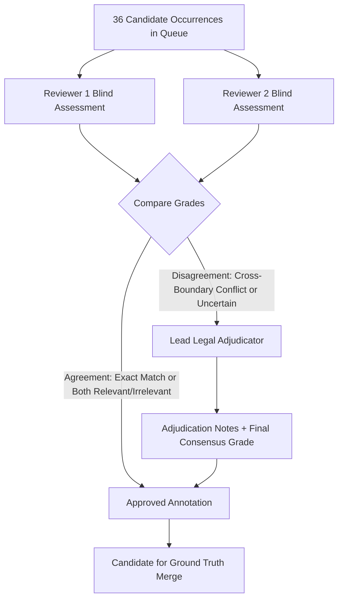

# JURIST AI — Expanded Retrieval Benchmark Annotation Guidelines
## Feature 1.5: Human-Reviewed Relevance Annotation Workflow

**Document Version:** `1.0.0`  
**Target Corpus:** 176 Unified Judgments (Landmark Precedents + Open India Law)  
**Target Dataset:** 36 Unjudged Precedent Candidate Occurrences  
**Applicability:** Legal Data Engineers, Judicial Annotators, and Research Reviewers  

---

## 1. Purpose & Principles

During Feature 1.4, the JURIST AI legal retrieval corpus was expanded from 27 curated landmark judgments to 176 authentic Indian court decisions. When evaluating the 15 benchmark queries across the expanded corpus, the three-way hybrid retrieval engine (TF-IDF + BM25 + BGE-small ONNX) surfaced **36 authentic Open India Law cases in top-5 ranking positions**.

Because the original benchmark ground-truth (`retrieval_benchmark.json`) was constructed exclusively when the corpus contained 27 cases, these 36 candidates are currently **unjudged**. They are neither confirmed positives nor confirmed negatives.

### Core Principles
1. **Never Infer Relevance from Retrieval Rank:** A judgment retrieved at Rank #1 may be a false positive (irrelevant), while a judgment retrieved at Rank #5 may be directly on-point. Annotators must judge the substantive text independently of ranking order.
2. **Text-First Evaluation:** Evaluate the actual judgment passages provided, examining the court's reasoning, statutory interpretation, and ratio decidendi. Do not rely solely on case titles, court names, or statutory section listings.
3. **No Automated Assumptions:** An authentic judgment from the High Court or Supreme Court is not relevant merely because it is authentic or cites the same statutory code.
4. **Strict Provenance & Auditability:** Every label must record reviewer ID, review timestamp, rationale, and specific textual evidence.

---

## 2. Graded Relevance Scale (5 Levels)

Annotators must assign one of the following grades to each query–judgment pair:

| Grade | Label | Operational Definition | Legal Standard in Indian Context |
| :---: | :--- | :--- | :--- |
| **3** | **Highly Relevant** | Directly addresses the query's core legal controversy and governing statutory provision. | Precedent would serve as primary binding or persuasive ratio decidendi in a written court petition or judicial order deciding this exact question. |
| **2** | **Relevant** | Substantively addresses the legal doctrine, rule, or test governing the controversy. | Precedent formulates the applicable statutory test, burden of proof, or constitutional standard, even if arising under a related procedural posture or closely analogous facts. |
| **1** | **Partially Relevant** | Provides related or contextual assistance, but does not decide the issue. | Broad discussion of the statutory code or constitutional maxim (e.g., Article 21 liberty, Section 482 inherent powers) without analyzing the specific operational issue. |
| **0** | **Not Relevant** | Does not meaningfully assist or address the query. | Incidental citation of a section number, procedural listing, or controversy concerning an entirely different substantive branch of law. |
| **uncertain** | **Uncertain / Inconclusive** | Insufficient text or ambiguous context prevents a confident determination. | The passage is truncated, corrupted by OCR noise, or requires reviewing the full original paper book. Escalated for lead adjudication. |

---

## 3. Indian Legal Domain Distinctions

Indian legal proceedings present specific linguistic and procedural challenges that annotators must strictly navigate:

### 3.1 Same Statutory Provision vs. Different Legal Controversy
Provisions such as **Section 482 CrPC** (inherent powers), **Article 226** (writ jurisdiction), **Section 138 NI Act** (cheque dishonour), and **Section 34 Arbitration Act** (setting aside arbitral awards) are invoked across thousands of wildly disparate controversies.
- *Negative Example:* A query asks for precedents on *refusal to register an FIR under Section 154 CrPC*. A retrieved judgment is an application under *Section 482 CrPC* seeking to quash a matrimonial FIR on the grounds of family settlement. Even though both cite the CrPC and involve FIRs, the matrimonial settlement case has zero bearing on mandatory FIR registration. -> **Grade: 0**.
- *Positive Example:* A Section 482 application where the High Court directs the police to register an FIR upon disclosing a cognizable offence following *Lalita Kumari*. -> **Grade: 3**.

### 3.2 Broad Topic vs. Specific Procedural Context
- **Bail Jurisprudence:**
  - *Section 438 CrPC:* Anticipatory Bail (pre-arrest apprehension).
  - *Section 439 CrPC:* Regular Bail (post-arrest custody).
  - *Section 167(2) CrPC:* Default / Statutory Bail (failure to file charge-sheet within 60/90 days).
  - *Guideline:* If the query specifically seeks *anticipatory bail* safeguards, a standard regular bail order considering medical grounds under Section 439 is at best **Partially Relevant (1)** or **Not Relevant (0)** unless it expounds general liberty doctrine applicable across all bail jurisdictions.

### 3.3 Cheque Dishonour (Section 138 NI Act)
- If the query specifically inquires into the *statutory presumption of legally enforceable debt under Sections 118 and 139*, a case deciding whether a cheque bounce complaint was filed within the 30-day limitation period under Section 142 is **Not Relevant (0)** or **Partially Relevant (1)**, because it does not examine the evidentiary presumption.

### 3.4 Procedural Dockets vs. Substantive Holdings
- Open India Law texts often contain court docket headers, counsel appearance lists ("Heard Sri X for applicant, Sri Y for State"), and routine adjournment notices.
- Annotators must bypass procedural dockets and locate paragraphs containing words like *"Held"*, *"Ratio"*, *"We are of the opinion"*, *"The principle emerged"*, or *"In view of the statutory mandate"*.

---

## 4. Two-Reviewer & Adjudication Protocol

To guarantee scientific rigor and inter-annotator reliability:

### 4.1 Agreement Criteria
- **Consensus:** Both Reviewer 1 and Reviewer 2 assign the identical numerical grade ($Grade_1 == Grade_2$).
- **Concordant Band:** Both assign grades within the same operational tier:
  - Both consider the case relevant ($Grade \in \{2, 3\}$).
  - Both consider the case non-relevant ($Grade \in \{0, 1\}$).

### 4.2 Disagreement & Adjudication Trigger
A record triggers **Mandatory Adjudication** (`disagreementDetected = True`) if:
1. One reviewer rates the case as Relevant ($2$ or $3$) while the other rates it as Non-Relevant ($0$ or $1$).
2. The difference between numerical grades is $\ge 2$ (e.g., $3$ vs $1$).
3. Either reviewer assigns `"uncertain"`.

### 4.3 Adjudication Process
- The Lead Legal Adjudicator examines both reviewers' notes and the underlying judgment passages.
- The Adjudicator records a reasoned decision in `adjudicationNotes` and assigns the final binding integer grade (`finalGrade` $\in \{0, 1, 2, 3\}$).
- If the Adjudicator concludes the record remains genuinely indeterminate, it is marked with status `"adjudicated_uncertain"` and permanently excluded from the retrieval benchmark ground truth.

---

## 5. File Formats & Deliverables

Annotators may complete their assignments using either of two synchronized interfaces:

1. **JSON Queue:** [`expanded_benchmark_annotation_queue.json`](file:///c:/Users/Gungun/Downloads/Jurist-AI-Team/ml-service/app/datasets/expanded_benchmark_annotation_queue.json)
   - Structured JSON array of 36 records.
   - Contains complete passage texts, cross-configuration retrieval ranks, and nested second-reviewer objects.
2. **Tabular CSV:** [`expanded_benchmark_annotation.csv`](file:///c:/Users/Gungun/Downloads/Jurist-AI-Team/ml-service/app/datasets/expanded_benchmark_annotation.csv)
   - 36 spreadsheet rows.
   - Ideal for legal annotators working in Excel, Google Sheets, or LibreOffice Calc.
   - Key columns to edit: `human_relevance_label`, `reviewer_id`, `review_status`, `reviewer_notes`, `relevance_evidence`.

---

## 6. Prohibited Practices

- **DO NOT** mass-fill labels without inspecting passage texts.
- **DO NOT** assume rank #1 indicates relevance.
- **DO NOT** edit or modify original benchmark queries or landmark citations.
- **DO NOT** fabricate reviewer names or consensus decisions.
- **DO NOT** include pending or uncertain records in finalized ground truth.
